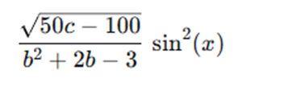
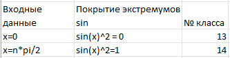
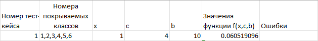
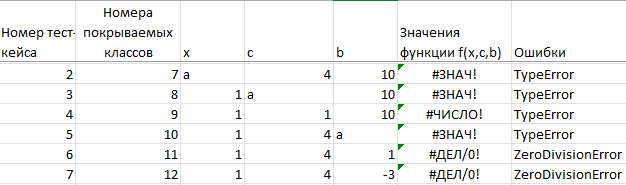
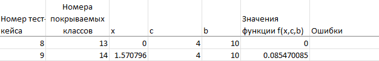
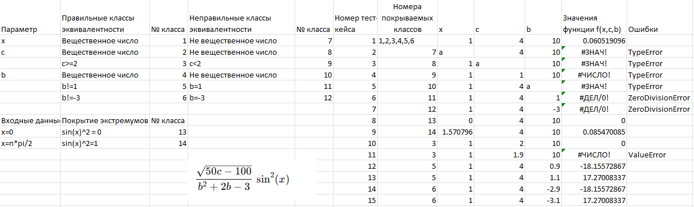

Правильные классы описывают параметры функции так что будет получено значение функции, неправальные - значение функции будет невозможно вычислить.

Также мы проверяем экстремумы тригонометрических функций

Спецификации тест-кейсов
Первый тест кейс покрывает все правильные классы

Каждый следующий тест кейс покрывает один неправильный класс

Каждый следующий тест кейс покрывает один экстремум

Каждый следующий тест кейс покрывает одно граничное значение правильного класса

Общий вид спецификаций

