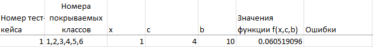
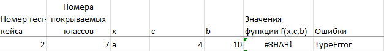
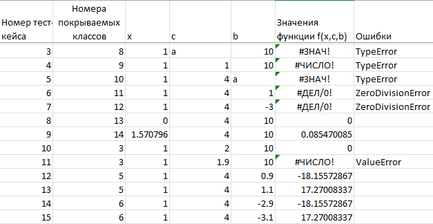

К каждой спецификации пишем тест кейс

def test_case_fx_1(self):
self.assertTrue(abs(f(1, 4, 10) - 0.060520) <= 1e-6)

def test_case_fx_2(self):
with self.assertRaises(TypeError):
f('a', 4, 10)

И так далее для всех остальных тест кейсов, не забываем указывать правильный тип ошибки

